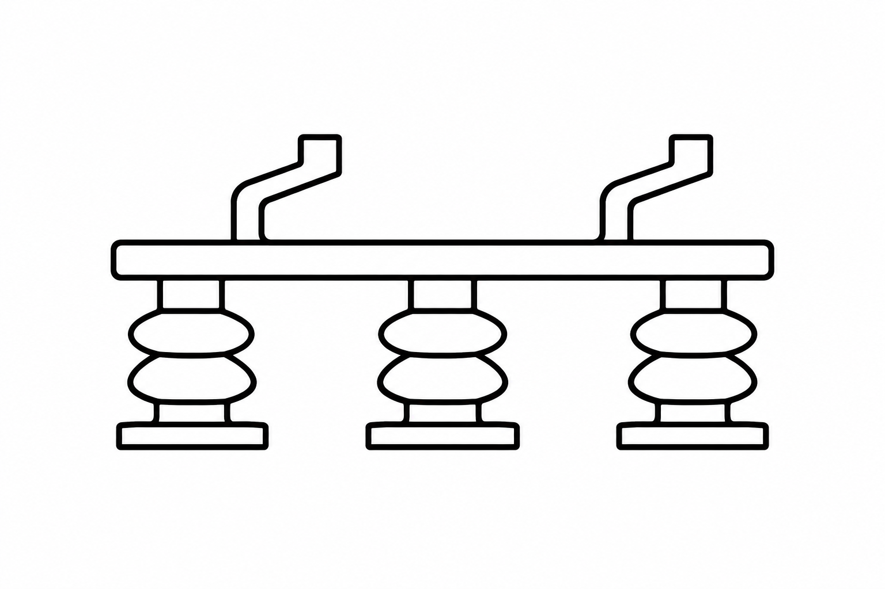
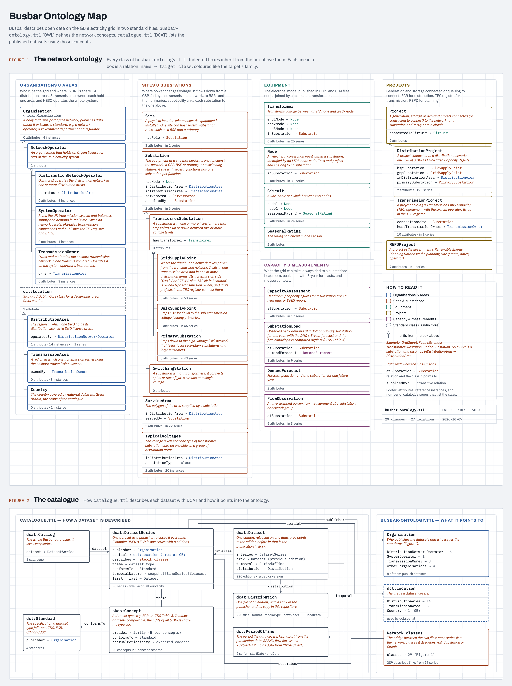
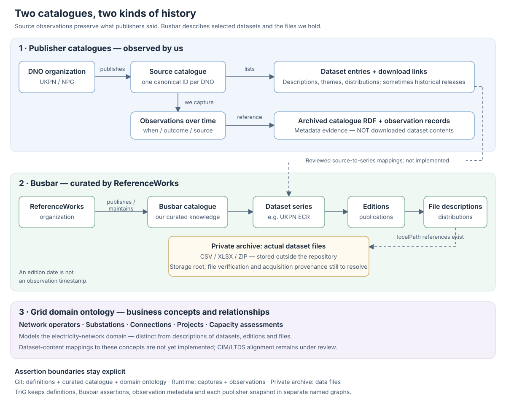

<p align="center">
  
</p>

<h1 align="center">Busbar</h1>

Busbar is an open-source catalogue of open datasets about the UK electricity grid. It records where datasets come from, what they describe, their geographic and temporal coverage, and their publication history, using established metadata standards to organise this information.

The project starts from a practical observation: finding a dataset is only the first step towards using it. Grid data is published across many organisations, with different formats, definitions and update cycles. Busbar helps users identify comparable datasets and follow successive publications, providing a clearer foundation for grid modelling, simulation and digital twin projects.

The core catalogue describes those datasets in two standard files, both written in [Turtle](https://www.w3.org/TR/turtle/) (`.ttl`). Curated publishing-source definitions and capture tooling extend this foundation (see below).

| File | What it contains | Standard |
|---|---|---|
| `busbar-ontology.ttl` | The vocabulary: network concepts (substations, circuits, projects…), dataset types, publishers, areas | OWL 2, SKOS |
| `catalogue.ttl` | The datasets: who publishes each one, what it covers, and every edition and file | DCAT 3, Dublin Core |

The ontology defines network concepts such as `busbar:GridSupplyPoint`, and the catalogue uses them. UKPN and Northern Powergrid publisher references now reuse the shared organization identities under `definitions/`, rather than separate uppercase identifiers.



*Historical diagram of the initial domain model and catalogue. It predates the shared organization identities and ORG/SKOS DNO-classification changes and is not an exact representation of the current ontology.*

## Architecture at a glance



For a changeset handover, see [catalogues, observations and archives](docs/catalogues-and-archives.md).
It distinguishes implemented source observation from future archive/source mappings.

## Shared organizations and catalogue identities

- UKPN and Northern Powergrid are `org:Organization` instances, classified as DNOs
  through `org:classification` and the local SKOS scheme in `vocabulary/grid-roles.ttl`.
- ReferenceWorks is defined in `definitions/organisations/referenceworks.ttl`.
- ReferenceWorks publishes and maintains Busbar, whose identity is defined in
  `definitions/grid/catalogues/busbar.ttl`.
- Busbar's series membership, editions and distributions remain in `catalogue.ttl`.
  Its catalogue identity is `https://busbar.example/id/grid/catalogues/busbar`.
- UKPN/NPG source catalogues keep their separate identities under
  `grid/uk/dno/{dno}/catalogue` and their publisher responsibilities.

See [shared foundation](docs/shared-foundation.md). No curated ECR-to-source mapping
or DNO/DSO equivalence has been asserted yet.

## Install and use from Python

Busbar requires Python 3.11 or newer. Install directly from GitHub with
[uv](https://docs.astral.sh/uv/) (pin a tag or commit for reproducible deployments):

```bash
uv add "busbar @ git+https://github.com/piotch/busbar.git"
# Optional S3-compatible storage support:
uv add "busbar[s3] @ git+https://github.com/piotch/busbar.git"
```

These commands require a revision containing the Python package. Until this branch
is merged, append `@feat/python-package` to the Git URL. Standard pip also works:

```bash
pip install "busbar @ git+https://github.com/piotch/busbar.git"
```

```python
import busbar

catalogue = busbar.load_catalogue()  # Fresh rdflib.Graph; no network access.
ontology = busbar.load_ontology()
declarations, hashes = busbar.load_declarations()  # Includes SHACL validation.
```

The wheel includes the curated catalogue, ontology, source definitions,
vocabularies, SHACL shapes and example SPARQL queries. Installing Busbar does not
capture remote catalogues or download datasets. S3 credentials are only needed
for explicit bucket operations; the core library has no boto3 dependency.

### Command line

```bash
uv run busbar capture --validate-only
uv run busbar capture
uv run busbar capture-all
uv run busbar build-observations
uv run busbar build-ontology
uv run --extra s3 busbar bucket check  # From this repository.
```

Each command has `--help`. In a consuming project, install the `[s3]` extra with
`uv add` as above, then use `uv run busbar bucket check` without `--extra`.
`python -m busbar` is also supported.

Captures and exports default to `captures/` and `build/` **in the current working
directory**, never inside the installed package. Use `--output`, `--captures`,
`--summary` or `--build` to select other locations. Bucket commands load `.env`
from the current directory (or `--env-file`); existing environment variables win.

### Development and releases

```bash
uv sync
uv run python -m unittest discover -s tests -v
uv build  # Builds an sdist, then a wheel from it in dist/.
```

`uv sync` installs an editable package. Keep editing the canonical RDF files at
this repository's root and under `definitions/`, `vocabulary/` and `shapes/`;
release builds bundle those same files without maintaining a second copy.
Commit `uv.lock` for reproducible repository development; consuming projects
resolve their own dependency versions. PyPI publishing is not configured yet.

## Viewing in Protégé

Generate an independent RDF/XML ontology containing the news/source vocabulary,
source definitions and the latest successfully captured UKPN and Northern Powergrid
DCAT catalogues. Shared identities, including Busbar and ReferenceWorks, are included.
The original grid-domain vocabulary and Busbar's curated series membership are
not merged into this flat viewer file:

```bash
uv run busbar build-ontology
open -a "$HOME/Applications/Protégé.app" build/news-catalogues.owl
```

The generated `build/` directory is ignored by Git. Edit the source Turtle files,
not the viewer export. One capture per publisher is included, with separate
catalogue membership and capture provenance; SHACL shapes are used for validation but are not merged into this file.
Capture both sources first if their observations are not present. The builder
fails rather than silently skipping a missing source. Select particular captures
with repeated `--observation captures/observations/<observation>.json` arguments,
or select sources with repeated `--spec <specification-IRI>` arguments. In Protégé, use **Entities** to browse classes and individuals;
enable **Window → Tabs → OntoGraf** for an interactive relationship diagram.

## Queryable observation history (TriG)

```bash
uv run busbar build-observations
```

This writes ignored `build/observations.trig`: one named graph per successful
capture, an observation metadata graph, a current-definitions graph, and a separate
Busbar curated-catalogue graph. These can be queried together without merging
publisher assertions with curator assertions.
Repeated observations remain separate even when their content is identical.
Failed acquisitions have metadata but no snapshot graph. Original publisher
identifiers are preserved inside each snapshot; canonical source identities are
linked through the metadata, not merged across historical states.

See [source tracking](docs/source-tracking.md#trig-observation-history) for
SPARQL examples. Protégé's flat OWL export remains a separate viewer artifact.

## Scheduled capture with GitHub Actions

The [Catalogue observations workflow](.github/workflows/catalogue-observations.yml)
can capture public catalogues daily and on manual dispatch, persisting history in
the S3-compatible bucket and publishing versioned exports. Pull requests only run
validation and tests; they never access bucket credentials.

Configure the repository secrets first—the local `.env` is not available on a
GitHub runner. See [GitHub Actions setup and storage](docs/github-actions.md).

## Tracking publishing sources

Git-managed Turtle declarations describe UKPN and Northern Powergrid, their
OpenDataSoft portals, source catalogues and DCAT capture endpoints. Their canonical
paths follow `grid/uk/dno/{ukpn|npg}/catalogue`, shared with
the intended UNS. Each source catalogue is distinct from Busbar's curated catalogue above.

With [uv](https://docs.astral.sh/uv/) installed, run from this repository:

```bash
# Validate the declarations without accessing the network.
uv run busbar capture --validate-only

# Capture UKPN (the default) and Northern Powergrid separately.
uv run busbar capture
uv run busbar capture --spec \
  'https://busbar.example/id/grid/uk/dno/npg/catalogue/captures/dcat'
```

Original responses and observation records are written under ignored `captures/`,
not committed to Git. Run a capture command again to compare catalogue membership
with the previous successful observation of that same specification. Standalone
commands are unscheduled; the GitHub workflow runs after repository setup.

See [source tracking](docs/source-tracking.md) for ownership, storage, limitations,
validation and the relationship to Django and the UNS.
