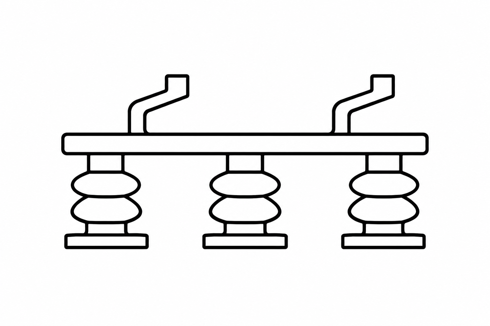

<p align="center">
  
</p>

<h1 align="center">Busbar</h1>

**Work in progress — research, not a production-ready data service.**
The models, identifiers and tooling are experimental and may change.

Busbar documents our research at ReferenceWorks into **UK electricity grid open
data and how to use it in energy-project development**. These activities are
sometimes called **“grid strategy”**: assessing connection opportunities and
constraints, and supporting project acquisitions and mergers (M&A).

The central research question is: **how can we use open data from different
publishers together to inform grid-strategy decisions?** We are working towards
a shared understanding of what each dataset describes and how it relates to the
others, without assuming that different publishers use the same definitions.

[**Explore the interactive ontology atlas →**](https://piotch.github.io/busbar/)

## What is here today

- **A curated catalogue** of selected datasets, series, editions and files
  (`catalogue.ttl`), alongside an experimental grid-domain ontology
  (`busbar-ontology.ttl`).
- **Source definitions and observation tools** for the six Great Britain
  distribution network operator (DNO) groups, preserving catalogue snapshots
  and acquisition history separately from our curated descriptions.
- **An initial dataset-collection example** for Electricity North West's
  Embedded Capacity Register, plus Python tools, queries and an interactive
  ontology atlas.

We build on existing standards: DCAT for dataset metadata, W3C ORG for
organizations, SKOS for classifications, and OWL for ontology modelling.
Their articulation with our local vocabularies is still being worked out.

**Coverage is partial.** A catalogue snapshot is not a download of all its
datasets. Some catalogue records refer to private archive files not included in
this repository. Cross-source mappings and CIM alignment are not complete;
this is not yet a harmonised UK grid model or a connection-assessment tool.

## Roadmap

1. **Clarify how the ontologies fit together — current focus.** Separate
   publishing and provenance metadata, organizations and roles, dataset series
   and editions, and grid-domain concepts; establish explicit, evidenced links
   between them.
2. **Generalise across the documents and datasets in scope.** Extend the approach
   beyond the initial examples, reviewing definitions, coverage and publication
   history rather than assuming similarly named sources are equivalent.
3. **In parallel, establish automated collection.** Build on the existing capture
   tools and optional scheduled workflow to collect catalogue metadata and
   selected dataset files reliably, with provenance and change tracking.
4. **Then relate the grid-domain model to CIM** (the Common Information Model),
   including relevant LTDS profiles. Review mappings concept by concept, recording
   evidence and limitations rather than claiming equivalence from names alone.

Initial CIM/LTDS research is documented, but does not yet constitute an ontology
alignment. These are research directions, not release commitments.

## Explore and contribute

- [Architecture: catalogues, observations and archives](docs/catalogues-and-archives.md)
- [Shared identities and ontology boundaries](docs/shared-foundation.md)
- [Source tracking](docs/source-tracking.md) and [series and editions](docs/series-and-editions.md)
- [CIM/LTDS research and pending review](docs/cim-ltds-alignment.md)
- [Installation, Python usage and development](docs/getting-started.md)
- [Interactive ontology atlas](visualisation/README.md)

To explore the atlas locally, run from the repository root:

```bash
python3 -m http.server 8000 --bind 127.0.0.1
# Open http://localhost:8000/visualisation/
```

The atlas requires internet access for its Three.js dependency. Feedback on
source interpretation, ontology boundaries and development use cases is welcome.

## Licence

The project is licensed under [Apache 2.0](LICENSE). Source datasets remain
subject to their publishers' licences and access conditions.
