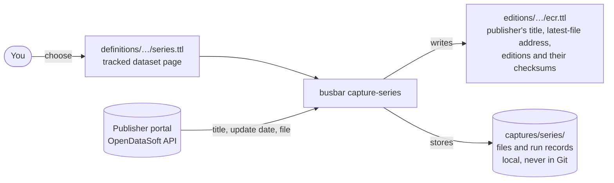

# Series and editions

A **series** is a publisher dataset we choose to follow over time, such as ENWL's
Embedded Capacity Register. An **edition** is one version of its file that we
hold. Only ENWL's ECR (part 2, 1 MW and above) is followed so far.

## Who writes what



- `definitions/` holds only decisions: which dataset page a series follows
  (`pub:tracksSourceDataset`). A `dct:title` may be added there to override the
  publisher's, but none is needed. Nothing there is
  rewritten by a program.
- `editions/` mirrors the `definitions/` tree and is written only by Busbar
  commands. Hand edits are lost at the next capture. Each file reads in order:
  the series and its latest-file address, then its editions from oldest to newest,
  each followed by its file.
- Files can hold personal data. They stay in `captures/series/objects/sha256/`,
  named by checksum, and are never committed, sent to the bucket or exported.

## Declaring a series

```turtle
<https://busbar.example/id/grid/uk/dno/enwl/series/ecr>
    a dcat:DatasetSeries ;
    pub:tracksSourceDataset <https://electricitynorthwest.opendatasoft.com/explore/dataset/enwl-embedded-capacity-register-2-1mw-and-above/> ;
    dcat:theme grid:DistributionProject1MWAndAbove .
```

`dcat:theme` says what the records are about, using the project types of
`vocabulary/grid-concepts.ttl`:

```text
Project
├─ Distribution project ("ECR project")
│  ├─ Distribution project, 1 MW and above   (threshold included; ENWL ECR part 2)
│  └─ Distribution project, below 1 MW       (ENWL ECR part 1)
└─ Transmission project ("TEC project")
```

Definitions come from `busbar-ontology.ttl`. These are local concepts: no CIM or
LTDS equivalence is asserted yet.

From the dataset page the capture derives:

- the portal, by matching the page's host with a declared portal's homepage; this
  gives the publisher and the name of the environment variable holding the API key
  (`pub:apiKeyVariable`, here `ENWL_API_KEY`);
- the OpenDataSoft metadata address
  `https://<host>/api/explore/v2.1/catalog/datasets/<id>` and the CSV export
  `…/<id>/exports/csv?use_labels=true`.

The key is only sent over HTTPS to a declared portal, and redirects are refused.
Only OpenDataSoft dataset pages are understood so far.

## What a capture does

`uv run busbar capture-series` (needs the key in the environment or `.env`):

1. Reads the publisher's metadata: title, update date, row count.
2. Records the publisher's title, the publisher and the latest-file address on
   the series in `editions/`. A declared title replaces the publisher's. The
   publisher's description is not recorded: on ENWL it is mostly portal
   boilerplate (disclaimers, sign-in links), and catalogue captures already keep
   it verbatim.
3. Stops there if the update date equals the last edition's.
4. Otherwise downloads the CSV, stores it, re-reads the metadata and fails if the
   date changed meanwhile or if the row count differs from the announced one.
   Without access, OpenDataSoft answers with the header row only.
5. Adds an edition only if the file's checksum is new. Editions are named after the
   publisher's update date, for example `…/enwl/editions/ecr/2026-10-20`.

Every run, successful or not, writes a JSON record in `captures/series/observations/`.

## Querying

`busbar build-observations` puts everything under `editions/` in the
`https://busbar.example/graphs/editions` named graph, apart from declarations.
Join it to the definitions graph through the series URI.

## Not yet done

- Recording the publisher's update date that was last seen, so that a new date
  with unchanged content does not trigger a download at every run.
- Portals other than OpenDataSoft, and publishers listing one file per month (NPG).
